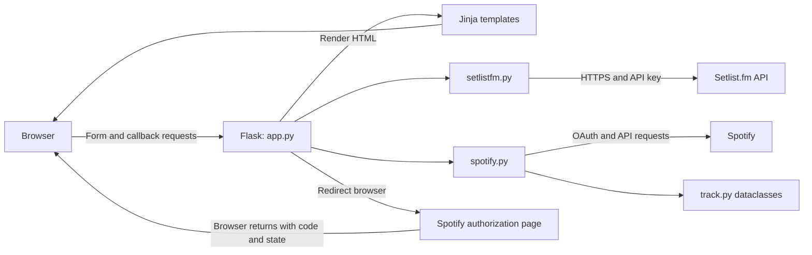

# Setlist converter: architecture and interview study guide

This guide describes the checked-out source. Deployment files show intended infrastructure; they do not establish what is currently running in Google Cloud. No live API calls or credential inspection were needed for this review.

## 1. Your opening explanation

“This is a server-rendered Python web application that turns a Setlist.fm concert setlist into a private Spotify playlist. Flask handles the form and OAuth callback, a Setlist.fm integration retrieves the performer and song names, and a Spotify integration searches for recordings and creates the playlist. Initial song searches run concurrently because most of the work is waiting on external APIs. The application is packaged in Docker, served by uWSGI, and configured for deployment through Google Cloud Build to Cloud Run.”

Understand each sentence before memorizing it. Keep claims about measured performance or current production behavior separate from what the source establishes.

## 2. Architecture map

This is a **monolith**: one deployable application, with modules dividing responsibilities. Calling two external services does not make its internal architecture microservices.

It is **server-rendered**: Flask renders complete HTML responses. The browser's JavaScript disables the submit button, shows a spinner, and removes callback query parameters from the displayed URL on the result page.

It is an **integration application**: the difficult work is coordinating authentication, external data, matching, and partial failures. There is no application database, queue, or background worker in this repository. However, implicit OAuth token caching means it should not be described as completely stateless.

## 3. File-by-file responsibilities

| File | Responsibility | What to explain |
| --- | --- | --- |
| `app/app.py` | HTTP routing and workflow orchestration | One `/` route handles GET, POST, callback, and error rendering. |
| `app/setlistfm.py` | Setlist.fm integration | Extracts an ID, makes an authenticated request, flattens sets into song names. |
| `app/spotify.py` | Spotify integration | Builds authorization URLs, exchanges codes, searches concurrently, creates playlists. |
| `app/track.py` | Data representation and mapping | Converts nested Spotify JSON dictionaries into Python dataclasses. |
| `app/templates/` | Presentation | Jinja inserts server data into HTML and conditionally displays errors. |
| `app/static/style.css` | Active page styling | Both templates load this plain CSS file. |
| `app/wsgi.py` | Production entry point | Imports the Flask application for uWSGI. |
| `app/wsgi.ini` | Web server configuration | Master process, five worker processes, HTTP listener on port 5000. |
| `requirements.txt` | Python dependencies | Compatible version ranges rather than a full dependency lock. |
| `Dockerfile` | Runtime image | Python Alpine image, temporary compiler dependencies, Python packages, uWSGI command. |
| `cloudbuild.yaml` | Deployment pipeline steps | Build image, push commit-tagged image, deploy to Cloud Run in `us-east4`. |

## 4. Follow one conversion end to end

1. The browser requests `GET /`. Flask renders `index.html`.
2. The user submits the form. The browser sends `POST /` with a `setlist_id` field.
3. `extract_setlist_id()` accepts a raw ID or takes the final hyphen-separated portion of a URL path and removes `.html`.
4. `spotify_auth_url_builder()` creates an authorization URL. The setlist ID is placed in the OAuth `state` parameter.
5. Flask returns a redirect. The browser visits Spotify, where the user can grant access.
6. Spotify redirects the browser to the configured `REDIRECT_URI`, supplying `code` and `state` on success. The route expects these at `/`.
7. `get_access_token(code)` exchanges the code for a user access token through Spotipy.
8. `get_setlist_songs()` requests the setlist JSON and returns `(artist_name, song_names)`.
9. `search_spotify_songs()` starts one initial search task per song, collects matching tracks, and runs fallback searches for unmatched songs.
10. `create_spotify_playlist()` obtains the current user's ID, creates a private playlist, and adds the matched track URIs.
11. Flask renders a result page, including unmatched song names when necessary.

The initial POST returns before conversion occurs. Conversion happens during the callback GET and occupies a web worker until completion. The thread pool operates within that request; it is not a durable background job.

## 5. HTTP, Flask, and Jinja

**HTTP request:** method, URL, headers, and possibly a body. `request.form` reads form fields from the POST body; `request.args` reads query parameters from the URL.

**Route:** a mapping from a URL and allowed methods to a function. `@app.route('/', methods=['GET', 'POST'])` registers `home()`.

**Redirect:** a response telling the browser to visit another URL. It does not itself perform the Spotify login on the server.

**Template:** HTML with placeholders and control flow. `{{ main_message }}` inserts a value; `` controls whether a block is rendered. Flask's normal HTML template configuration escapes inserted text.

**WSGI:** the Python interface between a web server and an application. uWSGI receives HTTP and invokes Flask through WSGI. Flask provides routing and application behavior; uWSGI provides the production serving process.

Why Flask fits: this project has a small HTTP surface and needs forms, templates, and integration logic. A larger framework could add conventions and features, but the current application does not need an ORM or an elaborate frontend framework to perform its core task.

## 6. OAuth: understand the trust boundaries

Setlist.fm uses an **API key**, identifying the application's access to that API. Spotify uses **OAuth authorization**, allowing the application to act with a user's granted permissions without receiving their Spotify password.

The Spotify client ID identifies the application. The client secret authenticates the application during the server-side exchange. The authorization code is a temporary credential returned through the browser. The access token authorizes API requests. These have different purposes and should not be used interchangeably.

The code requests `playlist-modify-private` to create and populate a private playlist and `user-read-private` to retrieve private profile information, including the market country used for searches.

`state` currently carries the setlist ID so the application knows what to convert when the browser returns. **Carrying workflow context alone is insufficient CSRF protection.** The route accepts the returned state without checking a browser-bound expected value. A stronger design generates an unpredictable state value, associates it with the browser's session and the chosen setlist, validates it on return, and consumes it once.

Another important boundary is token ownership. Search receives the callback token explicitly. Playlist creation instead constructs a new auth manager. Spotipy 2.23.0 normally writes tokens through a file cache when no custom cache handler is supplied; `check_cache=False` skips reading a cached token for that exchange, but does not disable saving its result. With no per-user cache selection in this code, simultaneous conversions can interfere through shared cache state. This is an inferred concurrency risk, not a reproduced production incident. Passing the current request's token/client into playlist creation would make ownership explicit.

Sources: [Spotify authorization code flow](https://developer.spotify.com/documentation/web-api/tutorials/code-flow), [Spotipy 2.23.0 OAuth implementation](https://github.com/spotipy-dev/spotipy/blob/2.23.0/spotipy/oauth2.py), [Spotipy 2.23.0 cache implementation](https://github.com/spotipy-dev/spotipy/blob/2.23.0/spotipy/cache_handler.py). The requirements allow later 2.23.x patches, so 2.23.0 is a reference implementation rather than proof of an installed version.

## 7. Setlist retrieval and data modeling

`get_setlist_songs()` calls a fixed Setlist.fm API host with the supplied ID in the path. It sends `x-api-key` and requests JSON. It checks for status 200, flattens songs from every set, and returns the headlining artist and song names in source order.

The flattening keeps the musical sequence but discards set boundaries and metadata such as cover attribution. Searching every song against the headlining artist is therefore a matching policy with consequences for covers and guest performances.

`Track`, `Album`, `Artist`, and related dataclasses represent Spotify metadata. Dataclasses generate common methods such as initialization and representation. Type hints document intended shapes; they do not automatically validate external JSON at runtime.

The mapper accesses many nested keys directly. A missing field can raise `KeyError` before playlist creation. The playlist writer only needs `Track.uri`; a smaller internal model would reduce coupling to the provider's response shape. The current mapper also assigns track artists to the album's artist field, even though those lists need not be identical.

## 8. Search, concurrency, and performance

For each song the initial query is `track:"SONG" artist:ARTIST`. `get_spotify_song()` creates a Spotify client, requests the user's country, searches in that market, and returns the first result containing an artist whose name matches case-insensitively. It does not independently verify title equivalence.

`ThreadPoolExecutor.submit()` returns a **future**, representing an eventual result. `future.result()` waits if necessary and raises the task's exception if it failed. Threads overlap network waits, making them suitable for this workload. They do not convert the Flask route into an async route.

The dictionary of futures is consumed in insertion order, so unique song names retain their source order even when requests finish out of order. A slow earlier task can delay processing completed later results.

Two subtleties to be ready to explain:

- Futures are keyed by song title. Repeated titles overwrite earlier dictionary values, collapsing repeated songs in the resulting playlist even though both initial tasks were submitted.
- Fallbacks change from the structured query to the raw song name, but start at offsets 10, 30, and 50 with a limit of 20. Because the query changed, skipping the first ten results is not justified by the initial search. Fallbacks run serially during result collection and check artist names without a separate title check.

For `n` songs with all initial searches successful, the code performs approximately `2n + 5` application-level outbound operations: one token exchange, one setlist request, two Spotify calls per song, and three playlist-stage calls. This excludes retries, refreshes, and browser authorization. Each fallback adds another profile request and search. Fetching the market once would remove repeated profile lookups.

Bound concurrency deliberately: multiple web workers can each create a thread pool, and multiple container instances multiply the API traffic. Concurrency reduces waiting but does not increase an external service's quota.

Source: [Python concurrent.futures documentation](https://docs.python.org/3/library/concurrent.futures.html).

## 9. Deployment and configuration

The Dockerfile starts from `python:3-alpine`, installs build tools needed for native Python dependencies, copies the application, installs requirements, removes build tools, and starts uWSGI. An image is the packaged filesystem and startup configuration; a container is a running instance of it.

`wsgi.ini` runs a master and five worker processes listening on `0.0.0.0:5000`. Direct execution of `app/app.py` instead starts Flask on port 5001. The `if __name__ == '__main__'` block is skipped when the application is imported by uWSGI.

`cloudbuild.yaml` defines build, push, and deployment steps and tags the image with `$COMMIT_SHA`. This helps associate a deployment artifact with a revision. The file does not prove that a build trigger exists, that checks run before deployment, or what settings the deployed service currently uses.

The app expects `SETLIST_FM_API_KEY`, `SPOTIFY_CLIENT_ID`, `SPOTIFY_CLIENT_SECRET`, and `REDIRECT_URI` in the environment. Locally, `load_dotenv('../.env')` resolves relative to the process working directory. Docker's documented `--env-file` usage injects variables at runtime. The image copies the `app` directory and requirements, not the root `.env` file.

The deployment command does not specify a port, and uWSGI hardcodes 5000. Verify the actual Cloud Run service port configuration rather than assuming it matches. The image's floating Python tag and compatible dependency ranges also mean the same commit need not rebuild with identical dependency versions.

Source: [Flask production deployment documentation](https://flask.palletsprojects.com/en/stable/deploying/).

## 10. Failures and improvements to discuss honestly

| Concern visible in source | Consequence | Concrete improvement |
| --- | --- | --- |
| Unvalidated OAuth state and implicit shared token cache | Callback integrity and user isolation risks | Validate session-bound state; pass the request's authenticated client explicitly. |
| Setlist request has no explicit timeout | A stalled dependency can occupy a worker indefinitely | Add a bounded timeout and handle network errors. |
| Search failures propagate from `future.result()` | One failed song lookup can fail the conversion | Distinguish provider outages from song-level failures and define partial-success behavior. |
| Duplicate song titles collapse | Playlist can differ from concert order and repetitions | Associate futures with sequence positions rather than names. |
| Loose fallback matching | Incorrect recording can be selected | Start changed queries at zero; normalize and compare titles; define version preferences. |
| Large nested response mapper | Missing metadata can break conversion | Use a minimal validated representation for needed fields. |
| Playlist creation and population are separate calls | Failure after creation can leave an empty playlist | Return the playlist ID, report partial completion, and offer safe retry behavior. |
| Callback performs playlist writes during GET | Callback replay can attempt work again; caching/retry semantics are awkward | Consume callback state once and track conversion completion. |
| Result uses `len(songs)` | Success count overstates added tracks when matches are missing | Report `len(tracks)` and distinguish matched from requested totals. |
| Raw exception text is rendered | Poor UX and possible implementation detail exposure | Log diagnostic detail server-side and show stable user messages. |
| No test suite or test stage appears in inspected files | Regressions are harder to detect | Add focused mocked tests before broad refactoring. |

Refreshing the callback is not a reliable retry strategy: authorization codes are short-lived and single-use. The result page removes query parameters with browser history manipulation after rendering, which helps presentation but is not server-side replay protection.

For higher traffic, first fix user isolation, correctness, timeouts, redundant calls, and bounded concurrency. A queue becomes useful if conversions need to survive requests, support retries, or expose progress; that adds job storage, workers, and a status UI. A database is justified by durable jobs, user history, or reliable idempotency requirements, rather than by user count alone.

## 11. Tests worth proposing

Use mocked external responses so tests do not require credentials or create real playlists.

1. URL and ID extraction, including empty and malformed input.
2. Multiple sets and enccores flatten in the intended order.
3. Out-of-order task completion preserves sequence and repeated titles.
4. Correct artist, incorrect title, no matches, and missing optional metadata.
5. Denied authorization and invalid callback state.
6. Two users' conversions always create playlists with their own tokens.
7. Partial match results report the correct count.
8. Playlist population failure reports the already-created playlist appropriately.

The existing source has only partial error boundaries: for example, Setlist.fm HTTP error statuses become a custom exception, but connection failures, JSON decoding failures, and missing response keys do not become that exception automatically.

## 12. Interview practice and learning sequence

Work through one topic at a time. For each one: explain it without looking, trace the relevant code, answer a failure scenario, then repeat the explanation more precisely.

1. **Architecture:** Give the opening explanation and draw the browser, Flask, and provider boundaries.
2. **Request lifecycle:** Trace GET, POST, redirect, callback, and template response. Explain where the conversion actually runs.
3. **OAuth:** Distinguish code, token, client secret, state, and scopes. Explain isolation between two users.
4. **Data:** Trace setlist JSON to song names to Spotify JSON to dataclasses to URIs.
5. **Concurrency:** Explain futures, ordered collection, duplicates, network waiting, and quota pressure.
6. **Runtime:** Trace Docker startup to uWSGI to Flask. Distinguish development and production ports.
7. **Engineering judgment:** Prioritize three improvements and explain why each comes before adding infrastructure.

Questions you should eventually answer confidently:

- Why is this a monolith, and why is that appropriate here?
- Why does writing a user's playlist require user authorization?
- What survives the trip to Spotify and back, and where is it stored?
- How could two users' requests interfere?
- What happens when the same song appears twice?
- What happens when one API is slow or unavailable?
- What does concurrency speed up, and what does it leave unchanged?
- Why are Python dataclasses useful, and what do they fail to validate?
- Why have both Flask and uWSGI?
- What does Docker package, and what must deployment still configure?
- What would you measure before changing the architecture?

Good measurement candidates: total conversion latency, provider latency, match rate, incorrect-match rate, rate-limit responses, conversion failures by stage, and partial playlist creations. Describe them as proposed metrics unless you have actual measurements.
